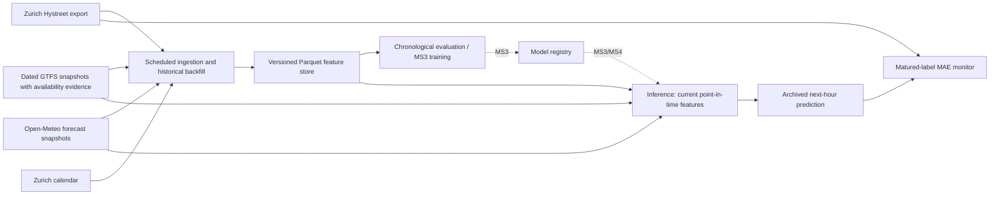

# gaeja — Predicting Pedestrian Flow

MS2 feature pipeline for the **total counted pedestrians in the next whole clock hour** at
Lintheschergasse, Zürich (Hystreet location **670**). Pedestrians are not customers. A short-horizon
signal may help immediate preparation, queue management or end-of-day promotions; it is not a
credible standalone basis for advance staffing or inventory planning.

## Status (5 November 2026)

Implemented and locally exercised: public ingestion, historical backfill, versioned Parquet,
availability-aware features, chronological baseline evaluation, forecast archiving, baseline live
predictions and delayed-label error monitoring. Tests and CI/container/scheduled workflows are included.
**GitHub execution:** implementation pushed; CI passed. Initial feature run ingested/backfilled,
evaluated and persisted its artifact but exposed a Linux timestamp-resolution mismatch in live
inference. A regression-tested fix normalizes availability times to nanoseconds; verification of
the corrected run is recorded below. Docker image
build and container CLI smoke test passed. The official 2026-11-04 GTFS ZIP was imported successfully;
113 Zürich HB arrivals were verified for 2026-11-05 16:00–17:00 UTC. Automated catalog access still
returns HTTP 403; no historical point-in-time GTFS backfill or ablation result is claimed. No cloud serving UI/model registry yet (MS3/MS4).

The proposal mentions an existing weather prototype. Its source was not provided and no prototype
code existed in this repository. This implementation is new and does not claim to reuse it.

## Architecture



Dashed registry connections are future work. Current live inference explicitly uses the versioned
`baseline-latest-v1`, not an unregistered fitted model. Shared feature definitions are in
[src/gaeja/features.py](src/gaeja/features.py). No pipeline imports notebooks.

## Clone and run

Install [uv](https://docs.astral.sh/uv/getting-started/installation/) and Python 3.13 (uv can provision it).
All direct and transitive dependency versions are pinned in [uv.lock](uv.lock).

```powershell
git clone https://github.com/0xff4b/gaeja.git
Set-Location gaeja
uv sync --locked --extra dev --python 3.13
uv run --locked gaeja ingest
uv run --locked gaeja backfill --start 2024-03-14T00:00:00Z --end 2026-11-05T00:00:00Z
uv run --locked gaeja evaluate --split 2026-10-01T00:00:00Z
uv run --locked gaeja live
uv run --locked gaeja monitor
uv run --locked pytest -q -W error
uv run --locked ruff check .
```

`--end` is exclusive. All CLI timestamps require timezones and backfill bounds must be exact hours.
`gaeja --data <directory> ...` changes storage (default `data`, or `GAEJA_DATA_DIR`). No secrets or API
keys are required. `.env.example` is documentation, not automatically loaded. Network failures for
counts fail the run without replacing stored data; weather failure is explicitly reported while
allowing count ingestion. HTTP retry/backoff and timeouts apply.

With Docker Desktop running:

```powershell
docker build -t gaeja .
docker run --rm --mount "type=bind,source=$((Get-Location).Path)\data,target=/data" gaeja ingest
```

Create the host `data` directory first; Linux bind mounts must be writable by the container user.
Run the same CLI subcommands after the image name. CI builds the image and checks its entry point.

## Sources, coverage and availability

### Pedestrian counts

[City of Zürich dataset](https://data.stadt-zuerich.ch/dataset/hystreet_fussgaengerfrequenzen), supplied
by hystreet.com GmbH. Public Parquet URL is declared in [sources.py](src/gaeja/sources.py).
The export contains `timestamp` (UTC interval start), `location_id`, `pedestrians_count`,
`collection_type`, and `unverified`. Hourly rows represent interval totals; no directional/zone totals
are summed again. Only nonnegative, verified `measured` records are accepted. Duplicate sensor/time
keys fail validation. **Zero placeholder rows for sensor 670 before installation are excluded.**

Observed on 5 November:

| Sensor | First measured UTC interval | Last measured UTC interval | Measured rows | Missing within range |
|---|---|---|---:|---:|
| 670 Lintheschergasse | 2024-03-13 23:00 | 2026-11-04 22:00 | 23,184 | 0 |
| 329 Bahnhofstrasse Mitte | 2021-09-28 22:00 | 2026-11-04 22:00 | 44,713 | 0 |
| 330 Bahnhofstrasse Süd | 2021-09-28 22:00 | 2026-11-04 22:00 | 44,700 | 13 |
| 331 Bahnhofstrasse Nord | 2021-09-28 22:00 | 2026-11-04 22:00 | 38,308 | 6,405 |

Thus the **target does not have five years of real labels**. The export was around 16 hours behind
at the initial fetch despite the catalog's hourly-update description. Do not assume lag1 is live.
Every fetch retains each interval's first-seen timestamp and writes a recent latency log. First-seen
latency is an upper bound sampled by the poller, not proof of exact publication time; initial
historical observations must not be interpreted as measured historical latency.

Historical backfill defaults to an explicit **24-hour publication-delay assumption**. At the
historical decision cutoff (10 minutes before target hour), the most recent eligible interval is
usually lag26. `--delay-minutes 15` enables an optimistic sensitivity run, not a verified operational
claim. Historical first-seen times do not exist; live mode instead uses actual first-seen timestamps,
never the assumed delay. Revised counts acquire a fresh value-availability timestamp; first-seen
latency is preserved separately. Historical revised values cannot be reconstructed without source
vintages, another explicit limitation of the backtest. Persistence uses the latest available count, maximum age 48 hours; the age
is itself a feature. Runs refuse a live forecast if that baseline is unavailable or too stale.

### Weather

Provider: [Open-Meteo Forecast API](https://open-meteo.com/en/docs), at 47.378 N, 8.539 E.
Archives temperature, precipitation, humidity, pressure and wind forecasts with **retrieval time**
as availability, separately from the forecast's valid hour. The API's past hourly values are not
claimed to be station observations. Only a forecast retrieved before the decision can enter features.
Current archive starts with this implementation's first successful poll; earlier weather features
remain missing, rather than using future-revised weather.

The [Historical Forecast API](https://open-meteo.com/en/docs/historical-forecast-api) is a stitched
forecast-model time series (generally from 2021/2022), not publication-vintage evidence for every
historical decision. It is deliberately **not** silently substituted into leakage-safe training.
Weather forecast backfill and separately sourced observations remain partial reviewer work.

### Public transport (GTFS)

Official source: [Swiss GTFS cookbook](https://opentransportdata.swiss/de/cookbook/timetable-cookbook/gtfs/)
and [2026 GTFS catalog](https://data.opentransportdata.swiss/dataset/timetable-2026-gtfs2020).

```powershell
uv run --locked gaeja gtfs-discover --year 2026
uv run --locked gaeja gtfs-import C:\downloads\gtfs.zip --source https://public-source.example/feed.zip
```

Discovery records resource URLs/metadata and falls back to the official archive listing when the
current catalog returns HTTP 403. The accessible archive lists 93 snapshots for timetable 2024,
115 for 2025 and 88 for 2026, plus older years back to 2016. A May 2026 ZIP downloaded and imported
successfully. Its HTTP Last-Modified is 2026-05-05, but this proves server modification, not exact
original public availability. Historical publication-vintage coverage therefore remains **unverified**
and the actual historical GTFS training window is **empty**. Download evidence is retained beside
snapshot metadata; filename dates are never silently treated as publication timestamps.
A failed discovery is not a successful backfill. The user-supplied official
`gtfs_fp2026_20261104.zip` was imported and tested on 5 November. Its service validity is
2025-12-14 through 2026-12-12, but proven availability defaults to import time
(2026-11-05 15:34:19 UTC), so it does not establish historical feature availability.
The archive is gitignored; filtered tables remain under `data/gtfs/`. Import an official ZIP to
start forward collection. Default availability is import time, never a date guessed from its name.
Only pass `--available-at 2026-...Z` when independent archived publication evidence supports that time;
retain that evidence in the source reference. Service validity dates alone do not prove publication.

Importer selects the exact `Zürich HB` station and its platforms, handles service exceptions,
GTFS times over 24:00 and service-day DST semantics, and counts arrivals per next-hour interval.
Snapshots carry content hashes, source, availability and service coverage. Backfill selects the
latest available snapshot whose validity covers the target, never later revisions. Missing coverage
is **NaN**, not zero. True covered hours with no arrivals are zero. Per-event neural encoding,
GTFS-RT delays and occupancy are deferred. A simple aggregate is the initial core feature.

Training without GTFS uses the longer count window. GTFS ablation uses only shared covered rows
for both variants (minimum 168 training / 24 test hours); it cannot yet run on real data. No claimed
GTFS benefit is inferred from synthetic tests. This is the primary remaining MS2 blocker.

### Calendar and feature semantics

Hour/weekday/weekend/month are computed in Europe/Zurich, with Zurich public holidays from `holidays`.
School-holiday values remain unknown unless a verified `config/school_holidays.csv` is supplied with
`start,end` ISO dates; each supplied year must contain a complete holiday schedule. No dates are invented.
Other Hystreet sensors are lagged spatial context only; the initial evaluation intentionally uses
only target lags/calendar. Missing clock hours stay missing; rolling windows require all constituent
intervals and their availability before the decision. Features include lags 1/2/3/6/24/168, means
3/6/24/168 ending at the latest eligible interval, latest count and age. Unavailable short lags stay NaN.

## Evaluation and monitoring

Frozen split: **2026-10-01 00:00 UTC**, test through 2026-11-04 22:00 UTC (839 common labeled hours).
Training labels must mature including the assumed publication delay before the split; no test labels
are used for fitting or parameter selection. Fixed `HistGradientBoostingRegressor` parameters and
seed 42, nonnegative predictions. This is an initial holdout, not a tuned performance guarantee.

Locally measured MAE with the default 24-hour publication-delay assumption:

| Forecast | MAE |
|---|---:|
| Latest available persistence | 227.42 |
| Seasonal naive (lag168) | 77.45 |
| Target lag/calendar model | 64.37 |
| Lag1 oracle (not deployable at this cutoff) | 84.16 |

The model is 16.9% below the better deployable baseline; threshold MAE is 69.71. This result is
conditional on assumed historical publication timing and revised source values, not proof of live
performance or GTFS benefit. Training uses 22,152 matured rows and ends before the first holdout decision.

The generated `data/evaluation.json` is authoritative. Results are also recorded in
[docs/ms2_summary.pdf](docs/ms2_summary.pdf). Success means MAE ≤ 90% of the **better deployable**
persistence/weekly baseline on identical rows. A lag1 oracle diagnostic is separately reported,
explicitly unavailable before the next target interval starts. Static timetables may add no value:
the paired GTFS/no-GTFS ablation is the intended MS3 headline result, including a null result.

Live baseline forecasts are immutable by target hour and carry model version and decision time.
After labels arrive, `monitor` writes MAE/sample counts for predictions and both baselines plus a
common-row comparison to `data/monitoring.json` and row-level Parquet. No matured labels yet is
reported as such, not zero error. This is basic monitoring, not drift detection or alerting.

## Scheduling, storage and reproducibility

[Hourly workflow](.github/workflows/features.yml): minute 50 UTC, plus manual dispatch. GitHub cron
is best-effort and may be delayed. The next complete UTC target hour is chosen at actual execution;
features include the actual decision time. Backfill/evaluation use fixed historical decision cutoffs.

Each run restores the last default-branch `feature-store` artifact, ingests counts/weather, backfills,
evaluates, predicts and scores matured labels. It uploads state even after downstream failure.
Concurrency serializes updates. Cross-run artifact download uses read-only `GITHUB_TOKEN` permissions;
no credentials embedded. **Retention is 30 days** and inactive repositories may have cron disabled.
This is a finite-retention MS2 store, not permanent cloud archival. Download an artifact before expiry,
or migrate Parquet to GCS for durable storage. Deleting/expiring the last artifact loses first-seen
and weather history; a fresh run can backfill counts but cannot reconstruct vintage forecasts.

Storage under gitignored `data`:
- `counts.parquet`, `latency.parquet`, `weather.parquet`: ingestion state.
- `features.parquet`, `versions/<run>/features.parquet` + SHA-256 metadata: versioned backfill.
- `gtfs/<hash>/`: filtered schedule and provenance, no full national ZIP in Git.
- `live/`, `predictions.parquet`, `monitoring.json`: immutable forecasts and matured-label scores.
- `coverage.json`, `evaluation.json`, `holdout_predictions.parquet`: auditable outputs.

Never commit data, models, credentials or MLflow artifacts. Before milestone submission, commit the
summary and source, push, verify the GitHub run, then create/push the milestone tag `ms2`.
No automatic commit/tag/push or cloud deployment is performed by the CLI.
